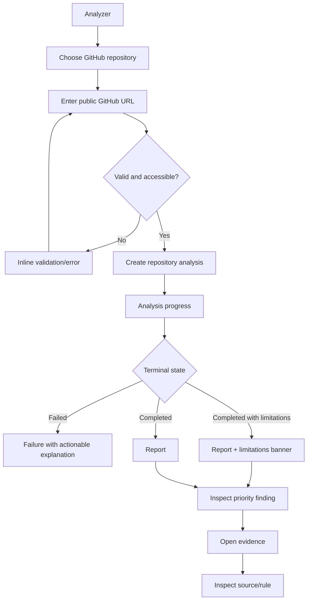
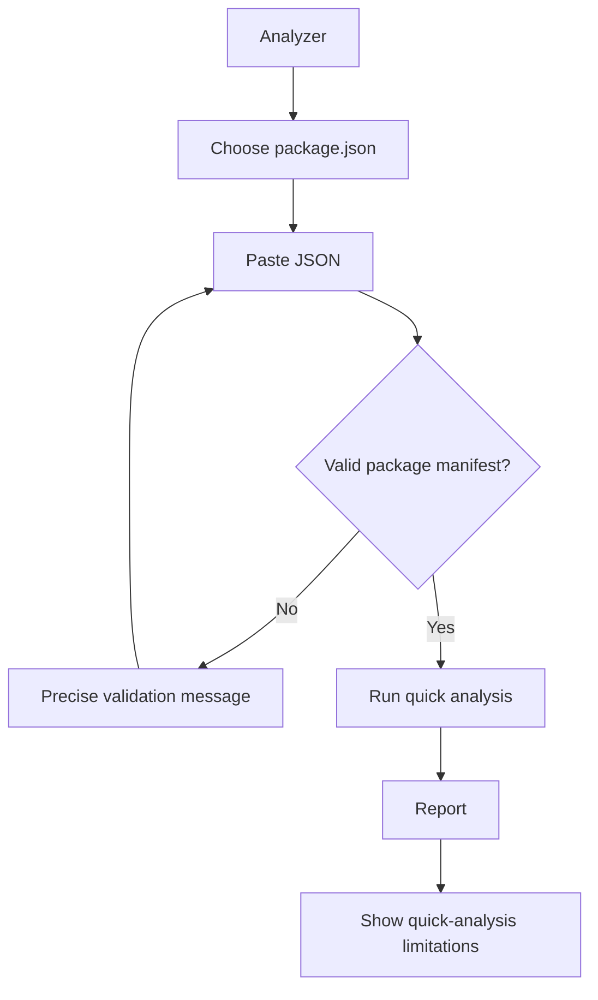
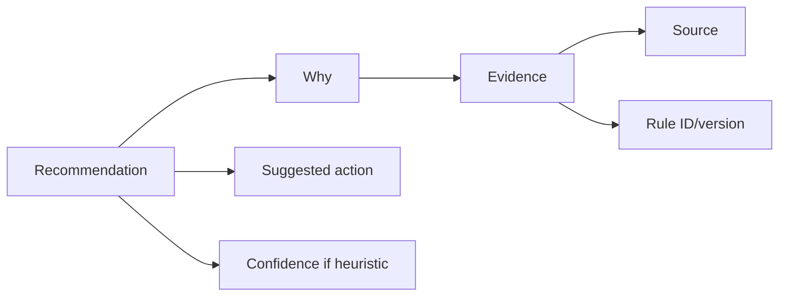
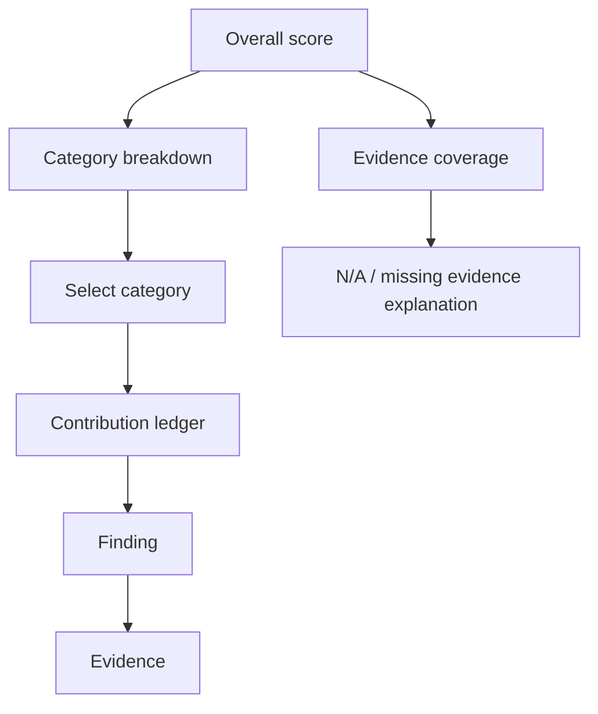

# StackLens MVP User Flows

## Flow C — Optional GitHub connection (FR-100)

Hosted activation is pending; the anonymous flows below remain available. When enabled, the
repository form offers a read-only GitHub connection and a separate selected-repository grant
link. Authorization happens on GitHub, then returns with a fixed success/error notice. Accepted
GitHub error callbacks, including optional error URI metadata, clear pending state before returning
to the error notice. The provider URI is never displayed or followed. The user
explicitly checks **Use my GitHub connection for this analysis** before entering a granted
repository. Help text, owner-only result copy and metadata disclosure describe private behavior.
Losing that session fails closed; the user reconnects or unchecks the option to choose public mode.
Switching modes clears the input, preventing accidental private-to-public submission.

Private report screens show the connection/sign-out control. Confirmed sign-out or expiry removes
cached analysis data and hides private results. Confirmed sign-out cancels pending session reads,
so a delayed pre-sign-out response cannot restore connected controls.
An expired cached session also hides connected controls/private results on the first render after
returning from a screen without a connection observer, before asynchronous cache cleanup or refresh.
Reconnection uses the same GitHub identity; other
accounts and anonymous requests receive the normal missing-analysis response. Text and semantic
alerts/status, native checkbox/links and existing Button focus styles support keyboard and narrow
layouts. No password, OAuth token or permission scope editor is rendered in StackLens. See
[the runbook](../implementation/github-connections.md) and ADR-0023.

## Flow A — Public GitHub repository analysis

**Requirements:** FR-003, FR-004, FR-005–FR-021, NFR-008



### UX rules

- Preserve the repository URL after validation errors.
- Do not present fake percentage progress if the backend only knows stage progress.
- Progress language should describe the actual architecture stage.
- Partial provider failures should not look identical to total failure.
- A status 404 stops automatic requests; Try again can recover and resume active-status polling.
- Closing inline evidence returns focus to its trigger, or the Findings heading if the trigger is gone.

## Flow B — Pasted package.json

**Requirements:** FR-001, FR-004, FR-022



### UX rules

The report must not imply source-level certainty. For example:

- package-use heuristics requiring imports may be unavailable;
- vulnerability matching may be N/A when no exact installed version can be established.

Local upload replacement clears stale content immediately, announces reading, and prevents submission
until the current file is ready. Switching modes preserves pasted text and invalidates pending reads.
Paste/file cards label native radio inputs from their visible titles and associate supporting text
as descriptions. Keyboard Space and arrow keys select modes with a visible focus indicator.
Quick-analysis completion announces the result and focuses the report heading. Analyze another
manifest clears the status and focuses the introduction, without initial-load autofocus.

## Flow C — Understand a recommendation

**Requirements:** PRD-001, FR-015, FR-017, DATA-001–DATA-006



The user should never need to trust a recommendation solely because "StackLens says so."

## Flow D — Understand a health score

**Requirements:** FR-018–FR-020, SCORE-001–SCORE-004



## Flow E — Narrow viewport

The same product order remains, but report navigation changes:

```text
Report header
Score summary
Attention queue
Category selector (horizontal/combobox)
Selected category content
Limitations
```

A desktop left rail must not be required to understand or operate the report.
